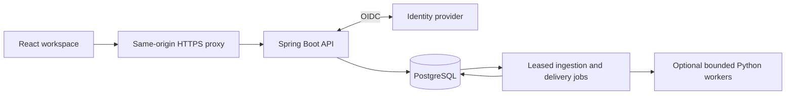

# FINN backend

Java 25 and Spring Boot 4.1.2 backend for an India-first portfolio intelligence and investment research platform. PostgreSQL 18.6 stores application data; Java owns domain decisions and database writes.

## Repository status

The application includes OIDC sign-in, an owner-scoped investment journal, private Groww holdings review and reconciliation, corporate actions, CSV export, watchlists, traceable current and dated valuations, completed-close alerts, review reminders, scheduled briefs, and private company sources and event threads. Public demos are synthetic. Private Yahoo completed-session acquisition is opt-in. Official exchange file imports and open-session streaming remain gated on source verification.

## Run locally

Use Node.js 24.22.1, a supported Java 25 LTS JDK (verified with Temurin 25.0.5+8), and Docker with Linux containers. The checksum-pinned Maven wrapper supplies Maven 3.9.16. No global Maven installation is required. Spring's [runtime requirements](https://docs.spring.io/spring-boot/system-requirements.html) describe compatibility.

From this repository in PowerShell, choose a private working directory outside every Git checkout:

```powershell
$env:FINN_WORKSPACE_ROOT = 'C:/path/to/private/finn-workspace'
$env:JAVA_HOME = 'C:/path/to/jdk-25'
New-Item -ItemType Directory -Force -Path $env:FINN_WORKSPACE_ROOT | Out-Null
node scripts/setup.mjs
node scripts/dev-services.mjs
node scripts/maven.mjs verify
node scripts/maven.mjs run
```

On Linux/macOS export the same variables and create the external directory, then use the same Node commands and Docker Compose command. The runner checks the working directory before starting Maven and keeps dependency downloads, wrapper files, JVM temporary files, compiled output and test reports under that directory. Use this runner rather than invoking Maven with arbitrary output paths.

Setup creates random development credentials outside Git and preserves existing files. PostgreSQL bootstrap, migration, identity-provider and runtime identities are distinct: the application role cannot create tables or read migration history. Restore existing secrets if they are lost; setup does not reset passwords in an existing database. Stop only this project's services with `docker compose stop`; no data removal is part of startup or shutdown.

The API binds to `127.0.0.1:8080`. `GET /actuator/health/readiness` includes database availability and suppresses details. `GET /api/v1/demo/quote` serves a curated fictional quote using public contract 0.57.0. `GET /api/v1/session` supplies authentication state and a CSRF token. `GET /api/v1/me` requires a signed-in user. Authenticated `GET`/`PUT /api/v1/preferences` read and save the current user's IANA display time zone, INR currency and delivery choices. Updates require CSRF and the last read revision. Concurrent changes return 409. The server derives ownership from the session. The holdings route accepts bounded raw workbook bytes.

Run the frontend at exactly `http://127.0.0.1:5173` and use its same-origin proxies. Sign in redirects to the local Keycloak realm at `http://localhost:8180/realms/finn-local`. Development-only synthetic account credentials are generated in the private `secrets/identity/demo-users.json` file under the working directory. Never commit or share that file. Keycloak stores identity records in its own database; the app stores only an issuer/subject link and display name. The packaged JAR is under `FINN_WORKSPACE_ROOT/build/backend`; running it needs Java and configuration but does not need Node.

The Node runner selects the `local` profile, which permits loopback HTTP only. Production must omit that profile, configure HTTPS `FINN_PUBLIC_ORIGIN` and `FINN_OIDC_ISSUER`, provide `FINN_OIDC_CLIENT_SECRET` privately, and register the exact `/login/oauth2/code/finn` callback and logout origin with the provider. No wildcard redirects are supported. Production uses a Secure, HttpOnly, SameSite=Lax `__Host-FINN_SESSION` cookie. The loopback profile uses `FINN_SESSION`. Sessions expire after 30 minutes idle and eight hours absolute lifetime; POST `/api/v1/logout` requires the session CSRF token and invalidates local access before provider logout. No provider token is sent to React. Configure a trusted same-origin HTTPS reverse proxy for the frontend, `/api`, `/oauth2` and `/login/oauth2`; the development server is not a production host.

API requests receive server-generated `X-Request-ID` references and no-store responses. Error responses contain fixed safe codes, with no request values or exception details. Limits include 64 KiB request bodies (5 MiB reserved for the import route), 32 concurrent API requests, bounded connection/thread/header settings, and separately bounded database connections. These are per-process capacity limits; deployment-wide abuse controls belong at the trusted reverse proxy. Module audit events contain only owner/resource IDs, action and time; the runtime role can append but cannot read, edit or delete that table.

The monitoring workers use saved completed-session observations. A rule's source and freshness settings determine eligibility. In-app delivery follows account preferences. Set `FINN_EMAIL_PREVIEW_ENABLED=true` for a local email preview sink and opt in from Settings. The preview records an attempt in PostgreSQL and sends no message outside the application.

File processing, optional provider acquisition, and local ranking use a separate scheduler from alert delivery and maintenance. Python workers have one deadline for execution and both pipes. Durable job leases preserve retries and reject completion from an expired claim. Existing ledger and stored prices remain readable while a provider request is unavailable.

Company research accepts manually reviewed primary HTTPS links and UTF-8 text up to 48 KiB. Secondary news entries store headlines, publisher details and links. Company event reviews retain exact source versions. Filing rules can notify on saved event updates or announced dates. The fictional replay uses a separate synthetic identity and never reads a user's portfolio.

For PDF extraction, create a Python environment under `FINN_WORKSPACE_ROOT` and install `integrations/research-pdf/requirements.lock.txt` with `python -m pip install --require-hashes -r integrations/research-pdf/requirements.lock.txt`. Set `FINN_RESEARCH_PDF_PYTHON` to that environment's absolute Python path and `FINN_RESEARCH_PDF_SCRIPT` to the absolute path of `integrations/research-pdf/extract.py`. The worker accepts private PDFs up to 3 MiB and indexes up to 20 pages within its text and time budgets. Image-only scans need a text layer produced by OCR. [pypdf extraction documentation](https://pypdf.readthedocs.io/en/latest/user/extract-text.html)

Unused PDF uploads can be discarded by their owner. Uploading another PDF also prunes the owner's unused files staged over seven days ago. Any PDF referenced by a saved source version stays with that evidence. Ledger CSV and original workbook downloads require the owner session. Saved workbook, journal, and research history are retained by the private deployment. Plan backup expiry and deployment-level deletion before onboarding additional users.

The research API stores reviewed financial figures and their source, period, unit and statement basis. Company reports save the passages and reviewed fact revisions used at generation time. Search supports source type, UTC publication dates and historical document versions. News links are available as metadata.

Investment theses retain each rationale, risk list, milestone, review decision, and evidence selection. Review dates connect to the existing one-time reminder worker. Conditions check exact reporting periods against reviewed figures and retain distinct outcomes. Guidance comparisons use the statement and results available by the selected date in India, with a separate state for interim evidence. Review tasks can pin an event, guidance comparison, and checked condition to a thesis revision. Each created task queues one notification and retains the review decision.

Discovery uses a private manually reviewed universe of up to 30 companies, with period and sector coverage drawn from reviewed facts. Saved runs retain the inputs and screen version. Relative peer scores use complete same-sector observations, average ties, and retain the factor weights and directions. The reports use the saved revisions available when captured.

Portfolio returns use complete same-revision account snapshots. XIRR uses actual days and a 365-day year, with an explicit unavailable state for cash-flow sequences with multiple sign changes. The time-weighted calculation geometrically links subperiods using an end-of-day external flow convention. Benchmark comparison is unavailable in the shipped configuration. [XIRR definition](https://support.microsoft.com/en-us/office/xirr-function-de1242ec-6477-445b-b11b-a303ad9adc9d), [Time-weighted return methodology](https://www.gipsstandards.org/standards/gips-standards-for-asset-owners/gips-standards-handbook-for-asset-owners/)

Portfolio health calculates equity weights from compatible closes, shows unrealised contributions where costs are known, and supports cash allocation and price-shock scenarios. Weekly observed drawdown and volatility require a complete selected weekly grid and valuations for external cash-flow days.

Reports use PostgreSQL keyword retrieval by default. To enable optional model ranking, run a trusted Ollama instance on loopback with `OLLAMA_NO_CLOUD=1` and an installed local model. Set `FINN_RESEARCH_MODEL_NAME` to its exact local name and `FINN_RESEARCH_MODEL_PORT` if it uses a port other than 11434. Each user chooses whether to submit matching excerpts to the model. FINN accepts up to three permitted anchor IDs, resolves them from its own data, and falls back to keyword results when ranking is unavailable. The per-owner limit is five queued ranking requests per hour and two outstanding requests. [Ollama local-only configuration](https://docs.ollama.com/faq#how-do-i-disable-ollama-s-cloud-features)

### Public stock research and news

Set `GROQ_API_KEY` in the backend process environment or put the key in `$FINN_WORKSPACE_ROOT/secrets/backend/finn.groq.api-key` for local use. Restart the backend after changing the key. FINN uses `openai/gpt-oss-120b` through Groq Browser Search and displays URLs matched to the browser tool's results. [Groq Browser Search](https://console.groq.com/docs/tool-use/built-in-tools/browser-search)

`Complete stock analysis` collects public evidence through Groq Browser Search and reads recent daily close history through the Yahoo adapter when available. Two tool-free, structured GPT-OSS 120B calls assess the evidence and critique the draft. Java derives the research recommendation from the available factors and review outcomes. If either later call fails, the response retains the sourced material and reports the incomplete stage. Browser evidence sent to the later calls contains public sources, bounded excerpts and optional Yahoo price context. [Groq Structured Outputs](https://console.groq.com/docs/structured-outputs)

`FINN_STOCK_AI_PROVIDER` accepts `GROQ`, `GEMINI`, or `AUTO`. The default `AUTO` selects Groq when configured, otherwise it uses a configured Gemini provider. Gemini reads `GEMINI_API_KEY` or `$FINN_WORKSPACE_ROOT/secrets/backend/finn.gemini.api-key`, and `GEMINI_MODEL` defaults to `gemini-3.8-flash`. Gemini requires a Google project with Search grounding access. The initial request contains the public stock identity and selected dated research prompt. Groq can use the official NSE issuer name from the verified directory for complete research and recent news. Reports remain in the open view for the current session. [Gemini API keys](https://ai.google.dev/gemini-api/docs/api-key) · [Google Search grounding terms](https://ai.google.dev/gemini-api/terms#grounding-with-google-search)

## Reviewed filing stream

FINN can publish reviewed company events and financial fact revisions to Kafka. Saving the review and adding its outbox row share a PostgreSQL transaction. The relay publishes a versioned reference with an owner/company partition key. Source documents, fact values, and portfolio data stay in PostgreSQL. Independent consumer groups evaluate Inbox alerts, update Radar, and check thesis conditions. Consumers commit database effects before acknowledging the record and record processed event IDs to handle redelivery. Radar can rebuild its projection from retained records.

The optional Compose stack adds a local Kafka broker, Prometheus and a provisioned Grafana dashboard. Run the usual local database and identity setup first. Then run these commands from `fin-service` with an existing external `FINN_WORKSPACE_ROOT`.

```powershell
$scrapeSecret = Join-Path $env:FINN_WORKSPACE_ROOT 'secrets/monitoring/scrape-password'
if (!(Test-Path -LiteralPath $scrapeSecret)) {
    New-Item -ItemType Directory -Force (Split-Path -Parent $scrapeSecret) | Out-Null
    $value = [Convert]::ToHexString([Security.Cryptography.RandomNumberGenerator]::GetBytes(32))
    [IO.File]::WriteAllText($scrapeSecret, $value)
}
docker compose -f compose.filing-stream.yaml up -d --wait
$env:FINN_FILINGS_KAFKA_ENABLED = 'true'
$env:FINN_METRICS_ENABLED = 'true'
$env:FINN_ACTUATOR_ENDPOINTS = 'health,prometheus'
$env:FINN_METRICS_PASSWORD = (Get-Content -LiteralPath $scrapeSecret -Raw).Trim()
node scripts/maven.mjs run
```

Open the [FINN filing stream dashboard](http://127.0.0.1:13000/d/finn-filing-stream/finn-filing-stream). Review a source-backed company event with an active filing alert rule to populate the latency charts. The dashboard also shows pending publications and processing, duplicates, and failed records. The metrics endpoint uses a dedicated scrape credential. The local stack binds published ports to loopback and runs Kafka with a single replica.

The main topic keeps 30 days of records. Exhausted retries move the record reference into a failure topic for seven days. Monitor that topic and the receipt backlog together. After correcting the cause, republish the original key and versioned reference to the main topic to retry only missing effects. Restore from PostgreSQL backups for recovery beyond Kafka's retained history. If the Kafka option is disabled, new reviews are processed inline. Already queued reviews still require a running relay and consumers.

## Verification

See [Deployment and recovery](deployment/RELEASE.md) for packaged deployment, encrypted archives, restore, and rollback.
See [Fictional replay](deployment/DEMO.md) for the generated workbook and end-to-end API scenario.
See [Stock directory](deployment/STOCK_DIRECTORY.md) for name suggestions, exact holding matches and automatic daily-price requests.
The Kafka integration test uses disposable Docker containers to stop and resume the Inbox consumer, rewind offsets, rebuild Radar, and check that the replay creates zero duplicate alerts. Set `-Dfinn.benchmark.filings=10000` and `-Dfinn.benchmark.report=<absolute path outside the checkout>` in `MAVEN_ARGS` to produce a recovery report. The latency in that report includes the simulated outage.

The k6 script at `deployment/filing-stream/k6-filing-reads.js` exercises Radar and Inbox for 15 seconds with four virtual users. Run it against the local stack with a fictional user's session cookie stored in a private external file. Set `FINN_BENCHMARK_URL` to the reachable API origin and `FINN_BENCHMARK_COOKIE_FILE` to that file's path as seen by k6. Invalidate the session and remove the cookie file after the run. [k6 load testing](https://grafana.com/docs/k6/latest/)



`node scripts/maven.mjs verify` compiles, tests and packages the application. Integration checks start real PostgreSQL containers, verify migrations and role restrictions, and exercise signed OIDC callbacks against a deterministic test provider. They check state/nonce/PKCE, session rotation, database expiry, CSRF and logout. Docker must be available; missing Docker is a failure, not a silently skipped database test.

The GitHub workflow runs the application and existing Python contract/adapter checks without live providers or personal reports. Build actions and the PostgreSQL image are pinned to verified immutable identifiers. Python check tools must use external environments/caches; their component READMEs document standalone commands.

## Available components

- Investment journal: owned account `/ledger` and `/transactions` under `/api/v1/portfolios/{portfolio}/accounts/{account}`. Record an existing buy/sell, fee, deposit, withdrawal, opening holding or closing cash baseline. Use exact decimal strings and a UUID `idempotencyKey` for each confirmed command. `/transactions/{event}/reverse` and `/correct` append linked records, validating the full effective-date sequence. Corrections keep original records; duplicates and concurrent overselling are checked using PostgreSQL transactions and row locks. The journal is append-only for the runtime role, with 10,000 events and 1,000 open positions per account and 100 records per history page.
- Ledger calculation: whole cash-equity units pooled by security, moving weighted-average recorded cost, and explicit unknown fees/cost. Cost allocation uses eight decimal places with HALF_EVEN rounding, with residual cost on final closure. Opening balances are closing-date boundaries; no earlier same-security trade or same-day cash movement is inferred. Deposits never become gains. Missing starting cash or fees prevents a complete cash balance. This is recorded portfolio accounting with partial coverage; no trading, tax lots or historical returns are produced.

- Portfolios and source accounts: authenticated `/api/v1/portfolios`, `/{id}`, `/{id}/accounts` and `/{id}/accounts/{accountId}`. Create INR tracking records with Groww/manual/other sources and unknown initial history. `POST /{id}/archive` accepts `archived` and the read revision to archive/restore; history stays readable and archived portfolios block new writes. All nested account queries bind the authenticated owner and actual portfolio. Scope is at most 100 portfolios per owner and 100 accounts per portfolio. No broker credentials or connection are required.

- Manual instrument catalogue: authenticated `/api/v1/catalog/companies`, `/securities`, `/securities/{id}`, `/securities/{id}/listings` and `/listings/{id}/symbols`. Companies, securities and exchange listings have distinct IDs. ISIN check digits are validated but never establish a listing. Explicit manually confirmed Yahoo symbols are optional and venue-checked. Effective-dated symbol history retains the same listing ID. Searches are owner-scoped and bounded; inaccessible nested IDs return 404. This is a personal catalogue, not a downloaded official exchange security master. Listings/history have explicit 100-record bounds per security/listing. The limited runtime role can lock operational columns without changing owner/identity columns.

- [Market-data and API contracts](contracts/README.md): exact decimals, listing identity, provenance, missing/stale states, planned routes and background-job states.
- [Yahoo history client](integrations/yfinance/README.md): bounded daily acquisition for explicitly mapped NSE/BSE listings in private mode. Streaming and universal coverage are unverified.
- [Portfolio import contract and reader](contracts/imports/README.md): private Groww-account `POST /imports` under the owned account path, raw XLSX media type and CSRF, plus list, `/imports/{id}/preview`, statically validated `/original` download, and `/retry` for recoverable job failures. The original bytes stay in the private PostgreSQL data volume with a 5 MiB limit, at most four concurrent uploads per process, 30 originals and two pending preview jobs per owner. Same-account identical bytes return the existing job. Durable lease claims, bounded retries and atomic preview staging recover from worker interruptions. The workbook lacks an explicit currency and venue; preserve source/detail discrepancies and original rows. Preview leaves the journal unchanged.
- Reviewed holdings acceptance: `POST /imports/{id}/accept` requires the current ledger revision, INR and unresolved-listing confirmations, acknowledgement of discrepancies when present, and either `UNITS_ONLY` or `REPORTED_ROW_COST`. One closing opening snapshot is allowed for a Groww account without prior equity entries. Securities/ledger events/receipt commit together. Same-source retry returns its receipt; equivalent same-date overlapping rows are duplicates and changed rows are conflicts. Later reports are comparison evidence. No trades, fees, cash flows, purchase dates or market prices are inferred from the workbook.
- Holdings reconciliation: `GET /imports/{id}/reconciliation` compares known recorded units/cost with the source rows at the report date and current ledger revision. Earlier dates than available coverage, unmatched holdings and unknown costs remain explicit. `POST` records acknowledgement for that exact revision; a newer journal revision needs a new review. Differences remain visible and no ledger entries are rewritten.
- Reviewed corporate actions: owned `/corporate-actions/preview` and `/corporate-actions` record source references, effective dates, effects, and linked corrections. Splits and bonuses preserve total recorded cost and apply before same-date trades. Dividend entries are net cash actually credited; repeated source references are idempotent and a competing active action cannot post twice. Symbol changes retain the listing ID and prior symbols. Fractional, merger, demerger and rights actions remain manual reviews without ledger writes. This feature records user-reviewed evidence; it does not fetch or verify company announcements.
- [Official EOD boundary](integrations/eod/README.md): acquisition references and parser acceptance requirements. Actual exchange-file schema validation remains pending; no EOD parser is shipped.

Each component documents its checks. Install dependencies and retain caches/output outside the checkout using `FINN_WORKSPACE_ROOT`.

## Application responsibilities

- Portfolio transactions, cash movements, import reconciliation, and financial calculations.
- PostgreSQL persistence, identity and ownership checks, and auditable corrections.
- Optional Yahoo Finance daily history and manually reviewed exchange closes.
- Watchlists, reliable alerts, reminders, filings, news, and evidence-based research.
- Investment thesis tracking, management guidance comparisons, and explainable stock screening.

Java owns domain logic and database writes. The bounded Python subprocess acquires Yahoo candidates; Java validates, retains, and selects observations. See the [private Yahoo setup](integrations/yfinance/README.md#run-private-daily-downloads). Choose an explicitly reviewed listing for each position. Reviewed exchange closes and optional Yahoo current estimates stay distinguishable. Historical snapshots use reviewed same-date closes and preserve the ledger revision, observation IDs, and calculation version. Missing data stays null.

## Repository boundaries

This repository contains production source, intentional tests and synthetic fixtures, configuration templates, API contracts, and maintained developer documentation. Planning and operational state live in the sibling `../project-workspace/` directory. That directory is local project material and is not uploaded with this repository.

Use an external `FINN_WORKSPACE_ROOT` for imports, provider downloads, caches, uploads, logs, temporary work, build output, and generated reports. On a standalone checkout, configure that location outside the checkout. Dependency installation directories must remain untracked.

Never store personal Groww reports, real portfolios, credentials, private company-document uploads, or copied market datasets in Git. Public demos use synthetic data unless reuse rights are established.

## Development workflow

Implement one reviewed backlog feature at a time. Run checks appropriate to the change, inspect the staged files, and commit a coherent completed change using a simple one-line message such as `Add transaction import validation`.

Frontend and backend changes have separate commits. Keep their shared API contract versions compatible. Operational requirements and phase progress are maintained outside both repositories.

## Data-source references

- [yfinance documentation](https://ranaroussi.github.io/yfinance/)
- [yfinance streaming reference](https://ranaroussi.github.io/yfinance/reference/yfinance.websocket.html)
- [NSE reports](https://www.nseindia.com/all-reports)

Market data can be missing, delayed, or unavailable. Source, observation time, and freshness must be visible in the application. Company research will retain primary-source evidence separately from news commentary.
